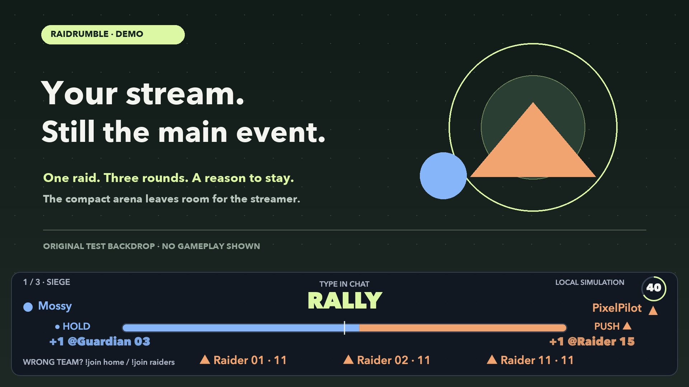
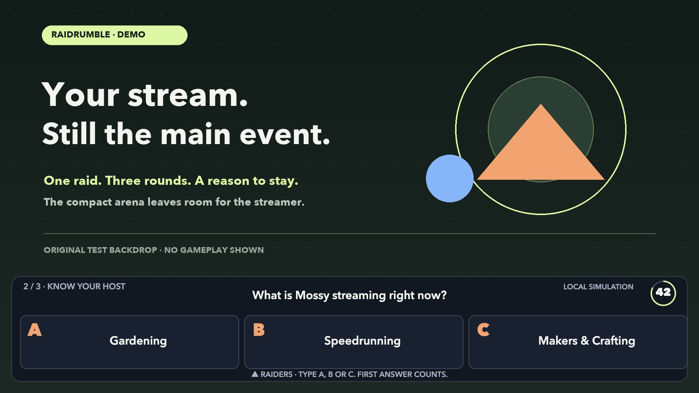
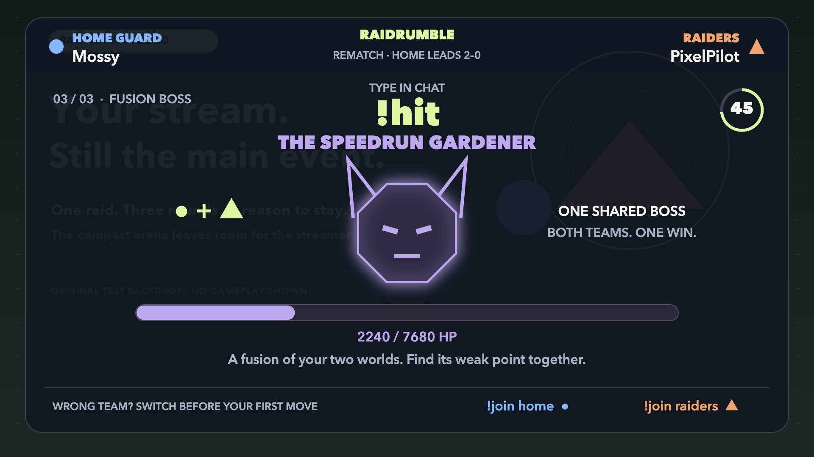
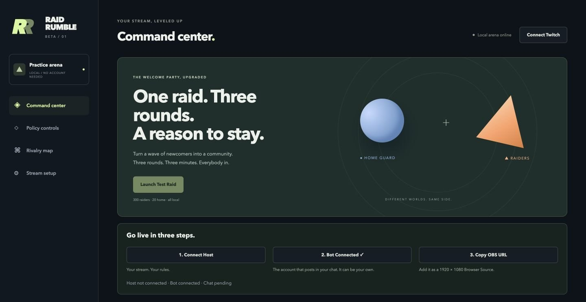

# RaidRumble

**One raid. Three rounds. A reason to stay.**



[Watch the demo · 2:29](https://youtu.be/quotIlkegbI) · [Devpost project](https://devpost.com/software/raidrumble) · [Public source](https://github.com/ocularminds/raidrumble) · [Build evidence](docs/codex.md)

Published November 1, 2026, with English captions. [Captions](docs/media/video.srt) · [Transcript](docs/media/video.md) · [Contact sheet](docs/media/contact.jpg) · [Video provenance](docs/video.json).

Submitted to the **Codex x TwitchCon Hackathon**. Final source and evidence are tracked in [PR #3](https://github.com/ocularminds/raidrumble/pull/3).

RaidRumble gives newcomers a shared game when they arrive. Raiders **orange ▲** meet Home Guard **blue ●**, compete, learn about each other, then fight one boss. The host chooses which raids enter.

## Try it in 60 seconds

Use **Node ≥20.19** (tested on 20.20 and 22) and the repository’s pinned pnpm.

```sh
pnpm i
pnpm dev
```

Open [the dashboard](http://localhost:5174) and click **Launch Test Raid**. No Twitch, OpenAI or Decionis account is needed. The real game modules run 300 simulated raiders against 20 home members.

Try different scenarios in the dashboard or terminal:

```sh
pnpm sim -- --scenario stranger-raid
pnpm sim -- --scenario hate-raid
pnpm sim -- --scenario collab
pnpm sim -- --headless --json
```

The stranger asks for approval; an unfamiliar two-day-old account is blocked. Headless mode needs no server. The [Warlord practice page](http://localhost:5174/warlord/demo) lets you try Battering Ram during Siege.

## How a rumble plays

- **Siege, 60s:** type the rotating keyword. Participation rate decides force; repeated messages count once per two-second window.
- **Know Your Host, 50s:** four A/B/C questions introduce each community to the other.
- **Fusion Boss, 60s:** both teams fight one category-themed boss, followed by a ten-second end card with MVPs and mutual follow invitations.
- **Afterglow, 5min:** counts tagged raiders who chatted in the last two minutes. It measures recent participation, not Twitch’s concurrent viewer count.

| Know Your Host                                                                   | Fusion Boss                                                                             |
| -------------------------------------------------------------------------------- | --------------------------------------------------------------------------------------- |
|  |  |

## Who is on which team?

| Priority          | Evidence                                                        |
| ----------------- | --------------------------------------------------------------- |
| Shared Chat       | Source channel identifies the team.                             |
| Authorized roster | Recent chatters from a raider who connected beforehand.         |
| Self-select       | `!join raiders` or `!join home` before scoring.                 |
| Heuristic         | Arrival time, regular status and an available chatter snapshot. |

Shared Chat stays authoritative. Other assignments can be corrected before scoring. Rosters stay in memory; the ledger stores aggregates. [Content and privacy details](docs/privacy.md).

## Your stream, your rules

The gate returns **ALLOW**, **BLOCK**, or **ESCALATE** before an action. New live hosts begin in Shadow Mode; switch to Enforce to hold unknown raids for ten-second approval. **Trust next time** saves a channel only after successful acceptance.

Match starts, content, specials and every Twitch write—including EventSub setup—pass through policy, guarded by an automated source check. Local mode needs no account; [Decionis hosted authority](docs/authority.md) adds verified signed dossiers and single-use execution grants.

## Built with Codex

Three round modules were generated as **overlapping sub-agent tasks in one build chat**, against the same `start / onInput / tick / result` lifecycle and serializable `view`. Each has deterministic tests.

[AGENTS.md](AGENTS.md) was the contract. [Timestamped evidence](docs/parallel.json) records the concurrent round work at **17:50:26–17:51:52 UTC, October 31**. Later user-recorded Codex clips show that contract and three subagents working on the enhancements; they do not depict the original round-generation moment.

The current enhancement checkout passes **609 tests across 71 files**, strict TypeScript, lint, production builds and all four headless scenarios. [Verification and evidence limits](docs/verify.md) distinguish those results from the historical 501-test checkpoint.

Codex session: `01a1930a-c3f4-7b53-b90a-a523ae252545`.

## Go live on Twitch

1. Register a Twitch app with an exact callback URL; follow [live setup](apps/server/src/live/README.md).
2. Copy `.env.example` to `.env` and configure your Twitch app and deliberate bot identity.
3. Connect **Host**, then **Bot**. Your own account can serve both roles.
4. Copy the OBS URL into a **1920×1080 Browser Source**. **Lower Third** is default; Side Rail and Full Arena are available. Sound starts off.
5. Choose **Test Raid · Real Chat** for a clearly labeled practice on your own overlay, or receive a real raid.



Real-chat practice uses no automatic players, sends no Twitch messages, and leaves the real rivalry ledger untouched. It was broadcast on **babafesti** with the Lower Third OBS source: one account's real Twitch chat drove two test matches, and the public Twitch player showed a boss defeat and an Afterglow sample of **1**. This was a labeled test raid, with no actual incoming raid or measured retention lift. The published edit labels the captured quiz as an authored fallback and identifies local simulations separately.

A separate hosted probe started an isolated fictional match in **1,475 ms** using the production setup allowance. Its signed evaluation and execution binding were verified; the receipt request timed out after the match started. This probe and the Twitch practice broadcast are separate evidence. See [verification](docs/verify.md).

[Round plug-ins](docs/rounds.md) · [Demo provenance](docs/demo.md) · [Hosted authority](docs/authority.md)

**Make every raid count.**
